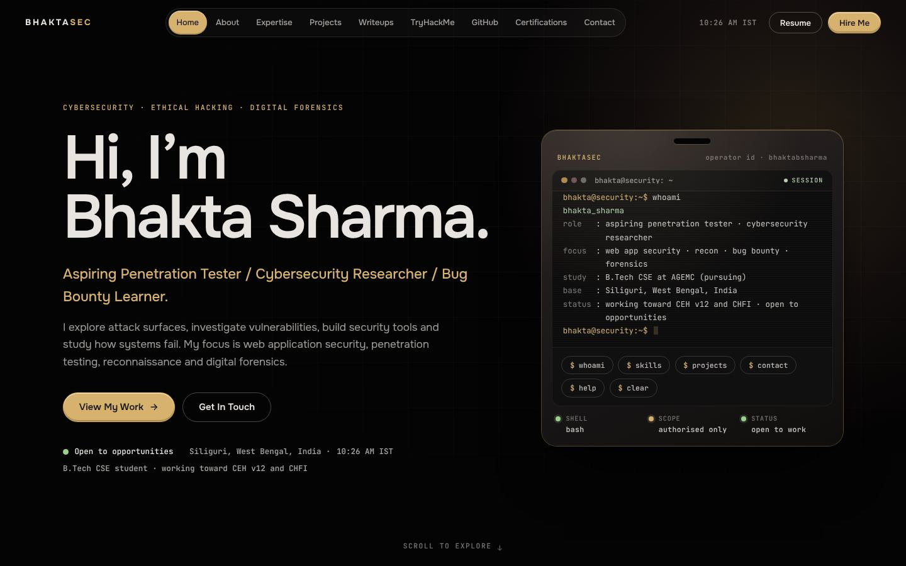
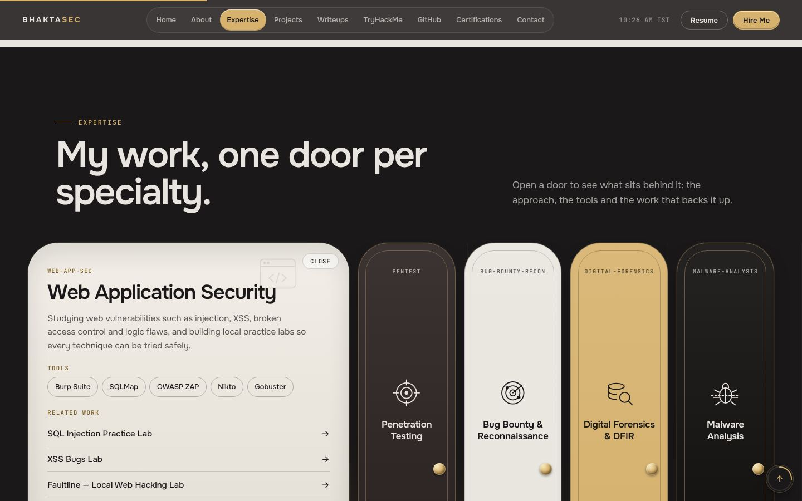
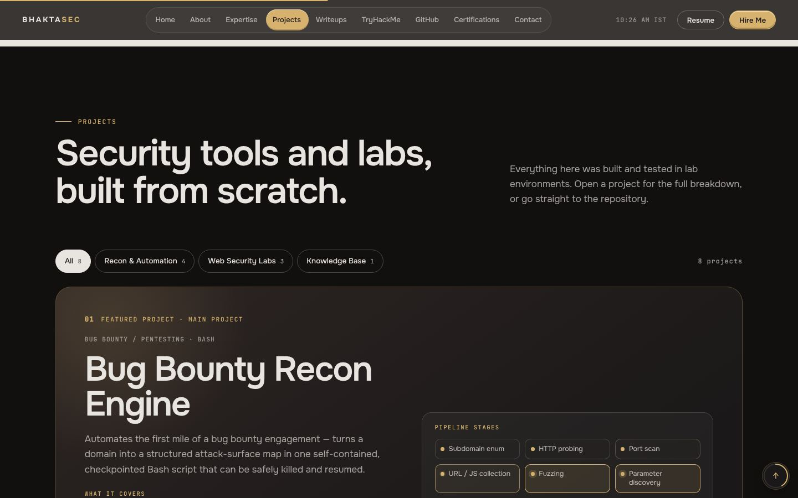
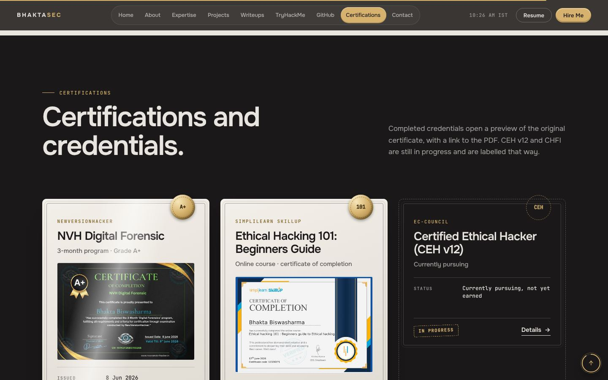

# BHAKTASEC · Bhakta Sharma's Portfolio

Personal portfolio of **Bhakta Sharma**, an aspiring penetration tester and cybersecurity researcher studying Computer Science and Engineering. It covers web application security, reconnaissance, digital forensics, open-source security tools, CTF writeups and certifications.

**Live site:** https://bhaktabsharma.github.io/Portfolio/

The site is plain HTML, CSS and JavaScript. There is no framework, no build step and no paid service, so GitHub Pages serves the repository as it is.

## Preview

| Hero and terminal identity card | Expertise doors |
| --- | --- |
|  |  |

| Project showcase | Certificates |
| --- | --- |
|  |  |

## Main features

- Editorial design in charcoal, warm ivory, muted gold and burgundy, with Onest for text and JetBrains Mono for labels and the terminal. Both fonts are self-hosted.
- Hero with an interactive terminal identity card (`whoami`, `skills`, `projects`, `contact`, `help`, `clear`).
- Five interactive expertise "doors" and one compact **Education & journey** timeline with resume buttons (view, PDF, plain text).
- Searchable tool catalogue: **38 tools** in six categories (including those from the Jr Penetration Tester and SOC Level 1 paths), each with a summary, the writeups and projects that mention it, and a link to its official documentation. No skill percentages.
- **8 projects** with category filters, a featured Bug Bounty Recon Engine layout, status labels, GitHub buttons and live demo buttons where a demo exists.
- **6 CTF writeups** and **12 TryHackMe room notes** shown in dialogs, plus an expandable list of **60 more rooms** from the completed learning paths.
- TryHackMe profile snapshot (manually maintained, with a visible "last verified" date).
- Live GitHub repository section with language filters, a forks toggle, caching and a saved-snapshot fallback.
- Certificate cards with previews of the original PDFs, view and download buttons.
- Resume as web page, printable A4 PDF and plain-text ATS version.
- Contact form that opens the visitor's email app, with validation and a copy-to-clipboard fallback.
- Respects `prefers-reduced-motion`, keyboard friendly, responsive from 320 px to 1920 px.

## Technology

| Area | Choice |
| --- | --- |
| Markup, styles, scripts | HTML5, CSS custom properties, vanilla JavaScript (ES2022) |
| Fonts | Onest and JetBrains Mono (SIL Open Font License, files in `assets/fonts/`) |
| Hosting | GitHub Pages through the workflow in `.github/workflows/static.yml` |
| Data | `js/content.js` (editable), GitHub public REST API (read only, no token) |
| Dependencies | None at runtime |

## Website structure

```
Portfolio/
├── index.html              all sections, static cards and the writeup <template> blocks
├── resume.html             printable, ATS-friendly resume
├── css/style.css           design tokens, layout, components, responsive rules
├── js/
│   ├── main.js             navigation, terminal, doors, timeline, dialogs, filters, form
│   ├── github.js           live GitHub data, cache, filters and fallbacks
│   └── content.js          editable data: statuses, TryHackMe, certificates, tools, projects, repos
├── assets/
│   ├── certificate.pdf     NVH Digital Forensic certificate (original)
│   ├── ceh_cert.pdf        Ethical Hacking 101 certificate (original, Simplilearn SkillUP)
│   ├── previews/           JPEG previews rendered from the two PDFs
│   ├── Bhakta-Sharma-Resume.pdf / .txt
│   ├── fonts/  readme/  favicon.svg  favicon-32.png  apple-touch-icon.png  og-image.png
├── robots.txt  sitemap.xml
└── .github/workflows/static.yml
```

## Projects

All repositories are public. Status labels are set in `js/content.js` and default to **Public repository** until you choose one.

| # | Project | Repository | Demo |
| --- | --- | --- | --- |
| 01 | Bug Bounty Recon Engine (featured) | [BugBounty-Recon-Engine](https://github.com/bhaktabsharma/BugBounty-Recon-Engine) | none |
| 02 | Automated Recon & Enumeration Toolkit | [ReconForge](https://github.com/bhaktabsharma/ReconForge) | none |
| 03 | SQL Injection Practice Lab | [SQL-INJECTION-LAB](https://github.com/bhaktabsharma/SQL-INJECTION-LAB) | none |
| 04 | Faultline, local web hacking lab | [Faultline-Web-Security-Labs](https://github.com/bhaktabsharma/Faultline-Web-Security-Labs) | none |
| 05 | ReconQL | [ReconQL-Passive-Recon-Console](https://github.com/bhaktabsharma/ReconQL-Passive-Recon-Console) | [live](https://bhaktabsharma.github.io/ReconQL-Passive-Recon-Console/) |
| 06 | Crawlspace | [Crawlspace-Attack-Surface](https://github.com/bhaktabsharma/Crawlspace-Attack-Surface) | [live](https://bhaktabsharma.github.io/Crawlspace-Attack-Surface/) |
| 07 | CaseFile | [CaseFile](https://github.com/bhaktabsharma/CaseFile) | [live](https://bhaktabsharma.github.io/CaseFile/) |
| 08 | XSS Bugs Lab | [XSS-Bugs-Lab](https://github.com/bhaktabsharma/XSS-Bugs-Lab) | none |

Several repositories were renamed on GitHub. The old names are kept as `aliases` in `js/content.js` so live data still matches them.

The Bug Bounty Recon Engine card lists what its README documents: subdomain enumeration, live host discovery, URL collection, parameter discovery, JavaScript endpoint extraction, API endpoint discovery and candidate generation. The output is a set of leads for manual review, not proof of vulnerabilities.

## GitHub API integration

`js/github.js` calls `https://api.github.com/users/bhaktabsharma/repos?sort=updated&per_page=100` from the visitor's browser. No token is used or stored.

- Shows repository name, description, language, stars, forks, open issues, last pushed date, and fork or archived badges.
- Featured projects first (set in `SITE.github.featured`), then a recently updated list with language filters. Forks are hidden by default and a toggle shows them.
- Results are cached in `localStorage` for 30 minutes (`SITE.github.cacheMinutes`) to stay within GitHub's anonymous limit of 60 requests per hour per IP.
- While loading, the page shows the saved snapshot with a loading status. If GitHub fails, is rate limited or returns something unexpected, the snapshot stays on screen and the status line says why. Older cached data is used first when available and is labelled with its date.
- The snapshot numbers (stars and forks) were checked against the public repository pages on 2026-11-11. Update `stars`, `forks` and `snapshotDate` in `js/content.js` now and then.
- The browser console may show one failed request when GitHub is rate limited. That is the browser reporting GitHub's HTTP 403 and is expected.

## Run locally

```bash
git clone https://github.com/bhaktabsharma/Portfolio.git
cd Portfolio
python3 -m http.server 8000      # or: npx serve .
# open http://localhost:8000
```

Opening `index.html` directly from disk also works, but use a local server to test the GitHub request and clipboard features.

## Deploy on GitHub Pages

1. Push to `main`.
2. In the repository go to **Settings > Pages** and set **Source** to **GitHub Actions**.
3. The workflow in `.github/workflows/static.yml` uploads the repository root and publishes it at `https://bhaktabsharma.github.io/Portfolio/`.

All paths in the site are relative, so it works under the `/Portfolio/` sub-path. Note that search engines only read `robots.txt` at a domain root; the file here is for completeness, and `sitemap.xml` can be submitted in Google Search Console.

## Updating the site

**Project information.** Card text lives in `index.html` (search for `id="project-..."`). Dialog text, status and demo links live in `js/content.js` under `projects`.
- `state`: `public`, `completed`, `in-development`, `experimental` or `archived`. The label comes from `statuses`.
- `demo`: add a URL to show a **Live demo** button.
- `github`: repository URL.

**TryHackMe statistics and rooms.** Edit `thm` in `js/content.js`: `stats`, `paths`, `lastVerified` (format `YYYY-MM-DD`) and `moreRooms` (the expandable room list, grouped by learning path). These are manual numbers, not live data, and the page says so. TryHackMe has no public API that this site uses.

**Certificates.**
1. Put the PDF in `assets/` (for example `assets/my-cert.pdf`).
2. Make previews: `pdftoppm -r 110 -png assets/my-cert.pdf out`, then save JPEGs as `assets/previews/my-cert.jpg` (about 1286 px wide) and `assets/previews/my-cert-thumb.jpg` (about 643 px wide).
3. Add an entry to `certs` in `js/content.js` with `status` set to `completed`, `pursuing` or `planned`, plus `issuer`, `title`, `dateLabel`, `credentialId`, `file`, `preview` and `thumb`. Only mark a credential `completed` when it has been earned.
4. Optionally add a `<template id="wp-your-id">` block in `index.html` for the longer details dialog.

**Resume.** Edit `resume.html` (and `assets/Bhakta-Sharma-Resume.txt` to match). To refresh the PDF open `resume.html`, choose Print, destination **Save as PDF**, A4, margins default, and replace `assets/Bhakta-Sharma-Resume.pdf`. Optional fields are marked with `EDIT:` comments, for example the expected graduation year and the diploma institution.

**Tools.** Tool tiles are in `index.html`; their dialog content (summary, features, usage, documentation link, and the optional `learned` list) is in `js/content.js` under `tools`. To add a tool, copy an existing tile in `index.html`, change its `data-tool` id and text, and add a matching entry in `content.js`.

## Contact form

The site has no server. Submitting the form opens the visitor's email app with the message filled in, and they press send there. The page cannot confirm delivery, so the success message says "your email app has opened" rather than "sent". Very long messages are copied to the clipboard as a safety net because some email apps shorten long links.

## Contact

- Email: bhaktabsharma@gmail.com
- LinkedIn: https://www.linkedin.com/in/bhaktabsharma/
- GitHub: https://github.com/bhaktabsharma
- TryHackMe: https://tryhackme.com/p/bhaktabsharma
- Instagram: https://instagram.com/beingbhaktaaaaa

## Credits

Design inspiration: therishithakor.com. Fonts: Onest and JetBrains Mono, both under the SIL Open Font License 1.1 (licence files in `assets/fonts/`).
